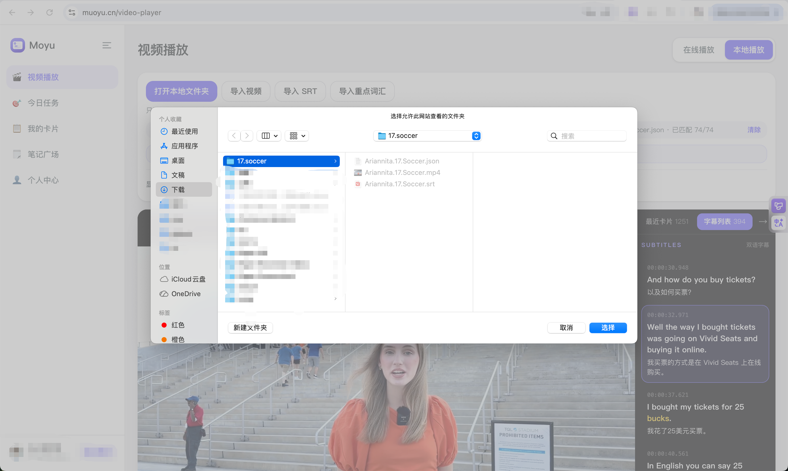
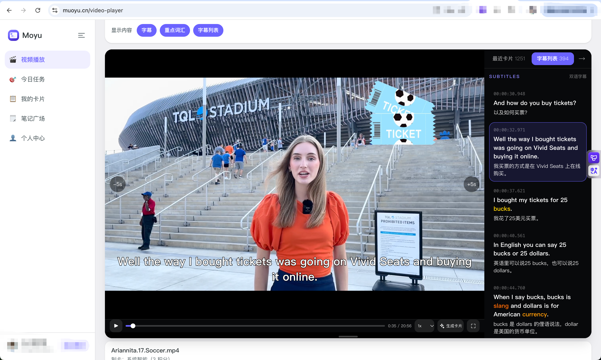

# Moyu Video Maker

将英文视频、公开视频链接或双语字幕制作成 Moyu 英语学习资源。

支持日常口语、四级、六级、考研、雅思、托福及自定义范围；输出同名 MP4、高亮双语 SRT 和词汇 JSON，可在 [Moyu 本地播放器](https://muoyu.cn/video-player?tab=local) 导入。

## 效果预览

### 导入本地资源

制作完成后，将同名的 MP4 视频、SRT 字幕和 JSON 词汇文件放在同一个文件夹中。在 [Moyu 本地播放器](https://muoyu.cn/video-player?tab=local) 中选择“本地播放”，点击“打开本地文件夹”，再选择成品所在文件夹。也可以通过“导入视频”“导入 SRT”和“导入重点词汇”分别载入文件。  




### 播放学习效果

导入后，可以结合视频画面和右侧带时间戳的双语字幕学习。截图中的当前句以紫色边框标出，`bucks`、`slang`、`currency` 等重点词汇以颜色突出显示。播放器还提供前后跳转 5 秒和倍速播放控件，便于反复听读。  




## 安装与使用

### 让 AI 帮你安装（适合新手）

如果你不熟悉终端命令，可以将下面这段话直接发送给 WorkBuddy 等支持技能安装或本地命令执行的 AI 工具：

> 请帮我安装这个 Skill：<https://github.com/fenicnn/moyu-video-maker> 。请先阅读仓库的安装说明，检查当前工具支持的技能安装方式，然后完成安装；如果需要我操作，请告诉我具体步骤。安装完成后，告诉我如何调用它。

AI 会根据当前工具的能力协助安装；如需授予本地操作权限或补充依赖，按工具提示完成即可。安装好后，参考下方“开始制作”，发送视频或链接并说明学习范围。

### 使用 npx skills 安装（推荐）

先安装 Node.js（包含 npm / npx），然后运行：

```bash
npx skills add fenicnn/moyu-video-maker -g
```

按提示选择要安装到的 AI 工具。`-g` 表示安装到用户目录，供所有项目使用；省略 `-g` 则安装到当前项目。仅安装到 Codex 时运行：

```bash
npx skills add fenicnn/moyu-video-maker -g -a codex
```

安装前可只检查技能是否可被发现：

```bash
npx skills add fenicnn/moyu-video-maker --list
```

若已下载或克隆本仓库，也可在仓库根目录运行 `npx skills add . -g`，或将 `.` 替换为本仓库的绝对路径。

命令与参数说明见 [skills CLI 文档](https://github.com/vercel-labs/skills)。安装完成后重新打开代理会话，再提交下方的制作指令。

### 手动安装

本仓库根目录就是技能目录。下载或克隆后，将整个目录放入支持本技能的代理工具的技能目录，文件夹命名为 `moyu-video-maker`。Codex 的默认位置为 `~/.codex/skills/moyu-video-maker`。重新打开会话以加载新技能。

已有本地仓库时，也可创建软链接（目标位置必须尚不存在）：

```bash
ln -s /absolute/path/to/moyu-video-maker ~/.codex/skills/moyu-video-maker
```

### 开始制作

安装后，在 AI 工具中提供素材，并说明希望按什么范围筛选词汇，例如日常口语、四级、六级或雅思 7 分。可以选择以下三种方式：

#### 1. 直接提供视频链接

将你有权下载使用的公开视频链接发给 AI，无需提前手动下载。技能会尝试下载视频并获取来源平台的字幕；缺少可用字幕时，再寻找其他字幕来源或使用已授权的云端转写服务。

> 使用 $moyu-video-maker，把这个视频制作成英语学习素材：[粘贴视频链接]。按雅思 7 分筛选重点词汇，生成可导入 Moyu 的 MP4、高亮双语 SRT 和词汇 JSON。

#### 2. 提供本地视频文件

将视频文件添加到对话中，或提供 AI 工具能访问的本地文件绝对路径。技能会先检查同目录字幕和视频内嵌字幕，再处理缺失的字幕内容。

> 使用 $moyu-video-maker，处理本地视频 `/path/to/video.mp4`，按四级范围筛选重点词汇，生成可导入 Moyu 的 MP4、高亮双语 SRT 和词汇 JSON。

#### 3. 同时提供视频和已有 SRT 字幕（推荐）

如果已经有与视频匹配的 SRT 字幕，请和视频一起提供，并明确两者的对应关系。建议将它们放在同一文件夹并使用相同文件名，例如 `lesson.mp4` 和 `lesson.srt`，便于识别。

与视频内容和时间轴匹配的字幕可以减少字幕查找与语音转写步骤，通常能更快、更准确地完成制作。英文 SRT 可用于生成中文翻译；已有中英双语 SRT 则可直接验证并进入标词流程。制作前仍会检查字幕与视频是否匹配。

> 使用 $moyu-video-maker，视频是 `/path/to/lesson.mp4`，配套字幕是 `/path/to/lesson.srt`。请优先使用这份字幕，按六级范围筛选重点词汇，生成可导入 Moyu 的 MP4、高亮双语 SRT 和词汇 JSON。

将示例中的链接、路径和学习范围替换为你的实际需求即可。三种方式最终都交付同名的 MP4、SRT 和 JSON 文件，导入方法见上方“效果预览”。

## 运行依赖

- Python 3.10+；处理脚本仅使用 Python 标准库。
- FFmpeg / ffprobe：媒体处理与最终音视频流校验。
- yt-dlp：仅下载公开视频链接时需要。
- 用户已授权的云端 AI：筛词、翻译、语境释义；缺少字幕时可能需要云端转写服务。

这是一套由 AI 代理编排的技能，不是独立网页服务。Python 脚本负责确定性处理，不能单独完成 AI 筛词和释义。云端调用可能产生费用。仅处理有权使用的素材。

首次制作前可执行只读环境体检（将脚本路径替换为实际技能安装路径）：

```bash
python3 /absolute/path/to/moyu-video-maker/scripts/doctor.py --source local
```

公开视频链接改用 `--source url`，已有字幕使用 `--source srt`。缺少依赖会返回非零状态并说明原因，不自动安装。技能安装目录只存放工具；缓存默认位于当前工作区的 `.moyu-work/`，成品位于 `output/`，也可指定其他位置。

完整操作规范见 [SKILL.md](SKILL.md)。字幕高亮脚本已内置，无需安装其他技能。

## 交付格式

```text
lesson/
├── lesson.mp4
├── lesson.srt
└── lesson.json
```

视频与字幕分开交付，不将字幕烧录进视频。词汇协议见 [播放器数据约定](references/studio-vocabulary-contract.md)。

## 开发与验证

```bash
python3 -m unittest discover -s scripts -p 'test_*.py'
python3 scripts/prepare_source.py --help
python3 scripts/moyu_pipeline.py --help
python3 scripts/publish_deliverables.py --help
python3 scripts/audit_media_batch.py --help
python3 scripts/ensure_canonical_mp4.py --help
```

## 已制作资源

| 资源名称      | 下载链接                                                             | 提取码    |
| --------- | ---------------------------------------------------------------- | ------ |
| Ariannita | [百度网盘](https://pan.baidu.com/s/1wXP5c7IvlcDUKjvGzh746Q?pwd=ftv1) | `ftv1` |
